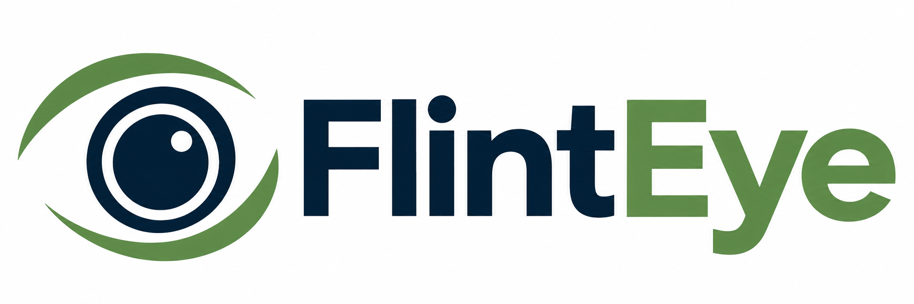
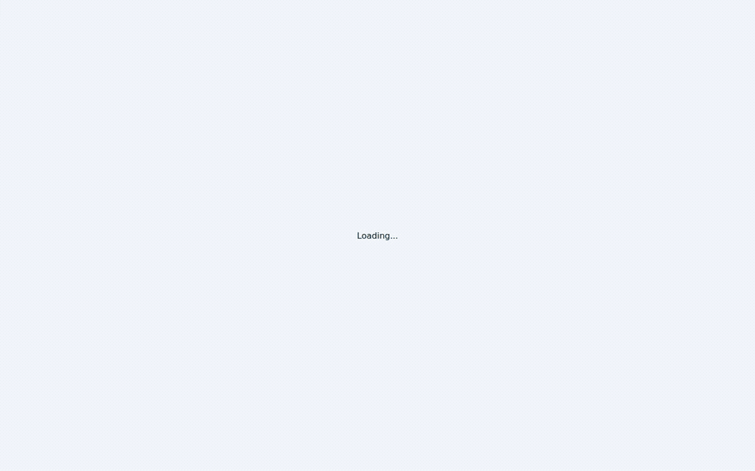

# 🚧 UNDER DEVELOPMENT — 開発中

**FlintEyeは現在開発中です。これは安定版ではなく開発プレビューです。テストには開発プレビューをご利用ください。**

[既知の問題](docs/KNOWN_ISSUES.ja.md) · [バグを報告する](https://github.com/noguhiro2002/FlintEye/issues) · [質問とアイデア](https://github.com/noguhiro2002/FlintEye/discussions)

<p align="center">
  <picture>
    <source media="(prefers-color-scheme: dark)" srcset="images/FlintEyeLogo-white.png">
    <source media="(prefers-color-scheme: light)" srcset="images/FlintEyeLogo.png">
    
  </picture>
</p>
<p align="center"><strong>あなたのカメラ。あなたの録画。あなたのコンピュータ。</strong><br>
USBカメラやIPカメラの監視、ライブ映像の視聴、録画の検索をブラウザで行えます。</p>
<p align="center">
  <a href="docs/RELEASING.ja.md"></a>
  <a href="https://github.com/noguhiro2002/FlintEye/actions/workflows/check.yml"></a>
  <a href="docs/INSTALL.ja.md"></a>
  <a href="LICENSE"></a>
</p>
<p align="center"><a href="README.md">English</a> · <a href="docs/README.ja.md">Documentation</a> · <a href="https://github.com/noguhiro2002/FlintEye/releases">Downloads</a></p>



*2台の実USBカメラ：**Live View → Multiview → Recordings**。現在の開発ビルドからLinux上でキャプチャしました。[MP4の視聴/ダウンロード](images/camera-workflow.mp4?raw=true)。*

<a id="quick-install"></a>
## クイックインストール

**開発プレビュー：[v1.1.3-preview.1](https://github.com/noguhiro2002/FlintEye/releases/tag/v1.1.3-preview.1)。** 以下のコマンドは、そのリリースのダウンロードアセットが一覧表示された後に動作します。実機での受け入れ確認は現在進行中です。お使いのコンピュータ用のコマンドを実行し、セットアップに従ってください。Python、FFmpeg、FFprobe、MediaMTXが同梱されているため、Gitのチェックアウトやコンパイルは不要です。

**Windows — PowerShell**

```powershell
irm https://github.com/noguhiro2002/FlintEye/releases/download/v1.1.3-preview.1/install.ps1 | iex
```

**macOS — ターミナル**

```sh
bash -c 'set -e; script=$(mktemp); cleanup() { rm -f -- "$script"; }; trap cleanup EXIT; curl -fsSL "$1" -o "$script"; bash "$script"' -- https://github.com/noguhiro2002/FlintEye/releases/download/v1.1.3-preview.1/install.sh
```

**Linux — ターミナル**

```sh
bash -c 'set -e; script=$(mktemp); cleanup() { rm -f -- "$script"; }; trap cleanup EXIT; curl -fsSL "$1" -o "$script"; bash "$script"' -- https://github.com/noguhiro2002/FlintEye/releases/download/v1.1.3-preview.1/install.sh
```

また、選択したリリースからスクリプトをダウンロードして内容を確認し、ローカルで実行することもできます。パッケージ版にはPython、FFmpeg、FFprobe、MediaMTXが含まれています。別途インストールする必要はありません。Windows/macOSパッケージは署名なし/公証されていません。[OS確認画面](docs/INSTALL.ja.md#unsigned-packages)をご覧ください。

<details>
<summary><strong>その他のインストールオプション</strong> — バイナリパッケージ、Docker、手動インストール</summary>

- **バイナリパッケージ:** Windows EXE、macOS DMG、Linux DEB/RPM。[インストールガイド →](docs/INSTALL.ja.md)
- **Docker Compose:** Linux x86-64およびARM64向けのバージョン管理されたGHCRイメージを使用します。[Dockerガイド →](docs/DOCKER.ja.md)
- **systemd:** デスクトップログインなしでLinuxサーバー上で常時実行します。[サーバーガイド →](docs/DISTRIBUTION.ja.md#systemd)
- **手動インストール:** 開発やカスタマイズのためにソースから実行します。[開発者向けセットアップ →](docs/MANUAL_INSTALL.ja.md)

pipアプリケーションパッケージは最初のリリースには含まれません。

</details>

<a id="quick-usage"></a>
## クイック使用方法

| Windows | macOS | Linuxデスクトップ |
| --- | --- | --- |
| スタートメニュー → **FlintEye** | アプリケーション → **FlintEye** | アプリケーション → **FlintEye** |

1. **管理者パスワードを作成します。** セットアップが自動的に開きます。ブラウザが開いたら `admin` としてサインインします。
2. **Settings でカメラを追加します。** 英語の入門ツアーに従ってUSBカメラまたはIPカメラを登録します。
3. **Live View を開きます。** Settings でカメラの録画を有効にし、**Recordings** を開いて保存された映像を再生します。

<details>
<summary>5ステップの初回実行ガイド</summary>


*UIツアー：カメラのないデモプロファイルを使用した、2026-11-15のQA修正を含むFlintEye 1.1.3ソース。これはインストール、実際の録画、停止、アンインストールではなく、5ステップのガイドを示しています。[高解像度MP4をダウンロード](images/getting-started.mp4?raw=true)。*

</details>

録画データはコンピュータ上に保存されます。初期制限は **7日間** および **最大50 GB**（または利用可能なディスク容量の半分のいずれか小さい方）です。いずれかの制限に達すると、最も古い完了済みの録画が削除されます。フォルダと制限は Settings で変更できます。

ブラウザを閉じても監視は継続して実行されます。設定を開いたままカメラを一時停止するには **Stop monitoring** を使用し、完全に終了するにはデスクトップメニューの **Quit FlintEye** を使用します。[ステータスカラーと起動設定 →](docs/MONITORING.ja.md)

[完全なユーザーガイド →](docs/USER_GUIDE.ja.md)


<a id="documentation"></a>
## ドキュメント

FlintEyeの使い方についての詳細は、**[ドキュメント](docs/README.ja.md)** をご覧ください。

| 入門ガイド | サーバーの運用 | 開発への参加 |
| --- | --- | --- |
| [インストール](docs/INSTALL.ja.md) | [Docker Compose](docs/DOCKER.ja.md) | [ソースのセットアップ](docs/MANUAL_INSTALL.ja.md) |
| [カメラと録画](docs/USER_GUIDE.ja.md) | [LANアクセスとsystemd](docs/DISTRIBUTION.ja.md) | [ビルドとリリース](docs/RELEASING.ja.md) |

<details>
<summary><strong>開発者デモ：Swagger API → WebRTC</strong></summary>


サインイン後に `/docs` を開き、`GET /api/v1/viewer/cameras` を試してから、同じFlintEyeサーバー上で返された `addresses.webrtc_url` を開きます。このデモでは、実際のUSBカメラと認証済みのローカルセッションを使用しています。[開発者用MP4の視聴/ダウンロード](images/api-webrtc.mp4?raw=true)。

</details>

<a id="license"></a>
## ライセンス

FlintEyeは、[追加の許可事項付き持続可能利用ライセンス](LICENSE)の下で**ソース利用可能（ソース・アベイルブル）**です。個人、非営利組織、大学、公的研究機関、企業を含む営利組織は、個人的または内部的な目的で利用および改変することができます。サービスプロバイダーは、顧客所有または顧客管理のインフラ（顧客の契約するクラウド環境を含む）上でのインストール、設定、改変、運用、保守に対して料金を請求することができ、FlintEye自体には料金を請求せずに必要なコピーを提供することができます。FlintEyeまたはその改変版を販売すること、あるいは有料のホステッドサービスとして提供することは、別途ライセンスが必要となります。[事例とサードパーティライセンス →](docs/LICENSING.ja.md)

<a id="acknowledgements"></a>
## 謝辞

- **[FFmpeg](https://ffmpeg.org/)** — カメラキャプチャ、映像処理、および再生変換。libx264を有効にしたFlintEyeの同梱ビルドはGPLライセンスです。リリースアセットには対応するソースとビルド手順が含まれています。
- **[MediaMTX](https://github.com/bluenviron/mediamtx)** — MITライセンスに基づくメディアトランスポートおよび録画。

サードパーティ製コンポーネントは元のライセンスを保持しており、FlintEyeの商業的制限からは除外されます。[サードパーティの権利表記](THIRD_PARTY_NOTICES.md)をご覧ください。
