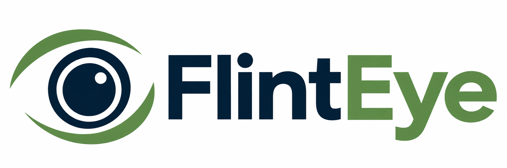

# 🚧 UNDER DEVELOPMENT

**FlintEye is under active development. This is a source-first preview, not a stable release. Public installers and container images are being prepared.**

[Known issues](docs/KNOWN_ISSUES.md) · [Report a bug](https://github.com/noguhiro2002/FlintEye/issues) · [Questions and ideas](https://github.com/noguhiro2002/FlintEye/discussions)

<p align="center">
  <picture>
    <source media="(prefers-color-scheme: dark)" srcset="images/FlintEyeLogo-white.png">
    <source media="(prefers-color-scheme: light)" srcset="images/FlintEyeLogo.png">
    
  </picture>
</p>
<p align="center"><strong>Your cameras. Your recordings. Your computer.</strong><br>
Monitor USB and IP cameras, watch live video, and find recordings in your browser.</p>
<p align="center">
  <a href="docs/RELEASING.md"></a>
  <a href="https://github.com/noguhiro2002/FlintEye/actions/workflows/check.yml"></a>
  <a href="docs/INSTALL.md"></a>
  <a href="LICENSE"></a>
</p>
<p align="center"><a href="README.ja.md">日本語</a> · <a href="docs/README.md">Documentation</a> · <a href="https://github.com/noguhiro2002/FlintEye/releases">Downloads</a></p>


*Two real USB cameras: **Live View → Multiview → Recordings**. Captured on Linux from the current development build. [Watch/download the MP4](images/camera-workflow.mp4?raw=true).*

## Quick Install

**Available now:** [run from source](docs/MANUAL_INSTALL.md), [build a local M1 Mac DMG](docs/LOCAL_MACOS_BUILD.md), or [build the development Docker image](docs/DOCKER.md#build-the-development-image).

Public installers are not available yet. The first planned download is **`v1.1.3-preview.1`**, after automated and real-device checks. It will be marked **Pre-release**, not Latest. Follow [Releases](https://github.com/noguhiro2002/FlintEye/releases) for availability. [Testing checklist →](docs/ACCEPTANCE.md)

<details>
<summary><strong>Planned one-command installation — available after the public preview is published</strong></summary>

These commands are examples for the planned preview and **do not work until that release is published**. They install a fixed development version, not an automatically selected stable version.

**Windows — PowerShell**

```powershell
irm https://github.com/noguhiro2002/FlintEye/releases/download/v1.1.3-preview.1/install.ps1 | iex
```

**macOS — Terminal**

```sh
bash -c 'set -e; script=$(mktemp); cleanup() { rm -f -- "$script"; }; trap cleanup EXIT; curl -fsSL "$1" -o "$script"; bash "$script"' -- https://github.com/noguhiro2002/FlintEye/releases/download/v1.1.3-preview.1/install.sh
```

**Linux — Terminal**

```sh
bash -c 'set -e; script=$(mktemp); cleanup() { rm -f -- "$script"; }; trap cleanup EXIT; curl -fsSL "$1" -o "$script"; bash "$script"' -- https://github.com/noguhiro2002/FlintEye/releases/download/v1.1.3-preview.1/install.sh
```

You can also download the script from the selected release, inspect it, and run it locally. Packaged builds include Python, FFmpeg, FFprobe and MediaMTX. No separate copies are required. Windows/macOS packages are unsigned/not notarized; see [OS confirmation screens](docs/INSTALL.md#unsigned-packages).

</details>

<details>
<summary><strong>Other Install Options</strong> — binary packages, Docker, manual installation</summary>

- **Planned binary packages:** Windows EXE, macOS DMG, Linux DEB/RPM. [Installation guide →](docs/INSTALL.md)
- **Docker Compose:** build locally now; versioned public GHCR images are planned for Linux x86-64 and ARM64. [Docker guide →](docs/DOCKER.md)
- **systemd:** run continuously on a Linux server, without desktop login. [Server guide →](docs/DISTRIBUTION.md#systemd)
- **Manual install:** run from source for development or customization. [Developer setup →](docs/MANUAL_INSTALL.md)

A pip application package is not part of the first release.

</details>

## Quick Usage

| Windows | macOS | Linux desktop |
| --- | --- | --- |
| Start menu → **FlintEye** | Applications → **FlintEye** | Applications → **FlintEye** |

1. **Create your administrator password.** Setup opens automatically. Sign in as `admin` when the browser opens.
2. **Add a camera in Settings.** Follow the English getting-started tour to register a USB or IP camera.
3. **Open Live View.** Enable recording for the camera in Settings, then open **Recordings** to play saved footage.

<details>
<summary>Five-step first-run guide</summary>


*UI tour: FlintEye 1.1.3 source with the 2026-11-15 QA fixes, using a demo profile with no cameras. This illustrates the five-step guide, not installation, real recording, shutdown or uninstall. [Download the full-resolution MP4](images/getting-started.mp4?raw=true).*

</details>

Recordings stay on your computer. Initial limits are **7 days** and **up to 50 GB** (or half the available disk space, whichever is smaller). Reaching either limit removes the oldest completed recordings. Change the folder and limits in Settings.

Closing the browser keeps monitoring running. Use **Stop monitoring** to pause cameras while keeping settings open, or **Quit FlintEye** in the desktop menu to exit completely. [Status colors and startup preferences →](docs/MONITORING.md)

[Full user guide →](docs/USER_GUIDE.md)


## Documentation

Visit our **[documentation](docs/README.md)** to learn more about how to use FlintEye.

| Get started | Operate a server | Build and contribute |
| --- | --- | --- |
| [Install](docs/INSTALL.md) | [Docker Compose](docs/DOCKER.md) | [Source setup](docs/MANUAL_INSTALL.md) |
| [Cameras and recordings](docs/USER_GUIDE.md) | [LAN access and systemd](docs/DISTRIBUTION.md) | [Build and release](docs/RELEASING.md) |

<details>
<summary><strong>Developer demo: Swagger API → WebRTC</strong></summary>


Open `/docs` after signing in, try `GET /api/v1/viewer/cameras`, then open the returned `addresses.webrtc_url` on the same FlintEye server. The demo uses a real USB camera and an authenticated local session. [Watch/download the developer MP4](images/api-webrtc.mp4?raw=true).

</details>

## License

FlintEye is **source available**, under the [Sustainable Use License with additional permission](LICENSE). Individuals and nonprofit or for-profit organizations, including universities, public research institutes and companies, may use and modify it for personal or internal purposes. Service providers may charge for installation, configuration, modification, operation and maintenance on customer-owned or customer-controlled infrastructure, including the customer's contracted cloud environment, and supply necessary copies without charging for FlintEye itself. Selling FlintEye or a modified version, or offering it as a paid hosted service, requires a separate license. [Examples and third-party licenses →](docs/LICENSING.md)

## Acknowledgements

- **[FFmpeg](https://ffmpeg.org/)** — camera capture, video processing, and playback conversion. Our libx264-enabled builds are GPL-licensed; release assets include corresponding source and build instructions.
- **[MediaMTX](https://github.com/bluenviron/mediamtx)** — media transport and recording, under the MIT license.

Third-party components retain their original licenses and are excluded from FlintEye's commercial restrictions. See [third-party notices](THIRD_PARTY_NOTICES.md).
