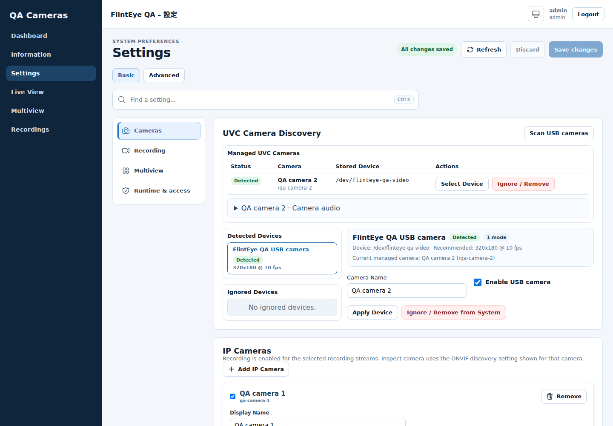
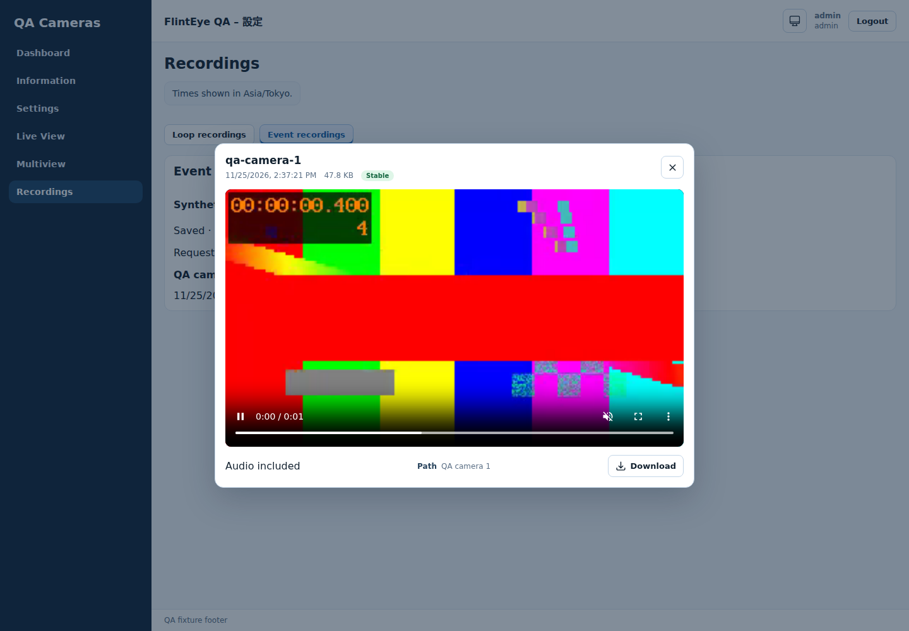

# FlintEye Preview 10 はじめかた

カメラを1台登録し、ライブ映像と録画を確認します。画面例にはテスト用の合成映像を使っています。

## 1. FlintEyeを開く

[インストールガイド](INSTALL.ja.md)に沿って、FlintEyeを動かすコンピューターにインストールします。Preview 10 のLinux検証用パッケージで試す場合は、同じビルドのZIPを展開し、そのフォルダーでインストーラーを実行します。

```sh
bash ./install.sh --user --package-directory .
```

アプリを開き、ブラウザーで最初の管理者パスワードを設定します。端末から起動した場合は、端末に表示されたアドレスとセットアップトークンの取得先を確認します。初回案内の **Next** を押すと順にカメラ設定、録画先の設定へ移動できます。後で案内を開くときは **Information → Getting started** を使います。

## 2. カメラを1台追加する

**Settings → Basic → Cameras** を開きます。スマートフォンでは **Category** から **Cameras** を選びます。

- USBカメラを接続したら **Scan USB cameras** を押します。**Detected Devices** から選び、**Camera Name** を確認して **Apply Device** で登録します。**Access denied** はFlintEyeを起動したアカウントのデバイス権限を、**In use** は他のカメラアプリを確認します。登録済みカメラの接続先を交換するときは、新しく検出したカメラの **Use this device for** から既存カメラを選びます。
- IPカメラは **Add IP Camera** を押し、名前とカメラの **Source URL** を入力します。**Inspect camera** で接続を確認し、**Save changes** を押します。



## 3. 保存先を選び、映像が届くことを確認する

**Settings → Basic → Recording** で **Recording Enabled** をオンにします。録画対象、**Recording folder**、容量上限と保持日数を選び、**Save changes** を押します。**Dashboard** が停止中なら **Start monitoring** を押します。映像が届いたら **Live View** でカメラを選びます。

複数の映像を1つにまとめる場合は **Settings → Basic → Multiview** で対象と **Layout preset** を選びます。プレビューのタイルにカメラを配置し、保存後に **Multiview** で並びを確認します。合成映像も録画する場合は **Recording** の **Include multiview paths** を選びます。

## 4. 録画を再生する

**Recordings → Loop recordings** で連続録画を開きます。**Stable** が表示された録画の **Play** を押します。スマートフォンでカメラや時刻を絞り込むときは **Show filters and sorting** を開きます。機器連携で保存した映像は **Event recordings** で再生できます。



別の端末で見る場合は **Settings → Basic → Runtime & access** でLAN/VPN接続を保存し、FlintEyeを再起動します。**Active address for other devices (HTTPS)** が表示されたら、閲覧端末に公開CAを登録してからそのアドレスを開きます。[LAN/VPN接続と端末別の証明書手順](LAN_ACCESS.ja.md)
